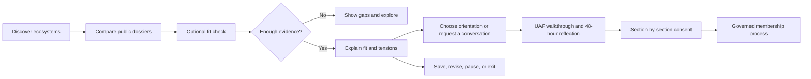

# NEOS Governance & Ecosystem Matching UX Guide

**Status:** Product and experience guide
**Audience:** Product, design, engineering, ecosystem architects, and governance stewards
**Scope:** Discovery, member-to-ecosystem fit, orientation, and entry—not authority assignment or admission automation.

## 1. Decision and design boundary

NEOS is a governance operating system, not a social network. It coordinates through explicit, versioned agreements; scoped, reviewable authority; ACT (Advice, Consent, Test) decisions; capture safeguards; and a voluntary, portable exit. An ecosystem is sovereign: its UAF and charter remain its own when it federates or collaborates with another ecosystem.

The matching feature must therefore be **decision support**, never a hidden admission, reputation, or authority engine. Its job is to help a prospective member answer:

> “Which ecosystem should I understand more deeply, and what must we discuss before I choose to join?”

It must not answer “Who deserves to join?” or “Who should hold power?” A high fit score does not create membership, consent, domain authority, a role, or directory visibility. Those are separate, governed processes.

### Non-negotiable product rules

- Do not auto-join, auto-reject, assign a member profile, or grant any domain role from a match result.
- Do not use wealth, donations, Current-Sees, popularity, social graph, message volume, tenure, or AI-inferred personality as a signal.
- Do not infer protected or highly sensitive traits. Collect only voluntary, purpose-specific information.
- Match against published, versioned agreements and documented domains—not a steward’s informal interpretation.
- Preserve pluralism: a difference in values is a conversation prompt unless the member explicitly identifies a published non-negotiable as incompatible.
- Explain every result in plain language, including uncertainty, source versions, and what could change it.
- Let a member edit, revoke, export, and delete their matching profile. Exit must remain easy and non-punitive.

## 2. What the framework requires from UX

| NEOS mechanism | UX consequence |
| --- | --- |
| Agreement hierarchy: UAF → ecosystem/access/stewardship → ETHOS/culture → personal commitments | Always identify the source agreement, section, version, ratification status, and review date. Never label a vague “value” as binding. |
| UAF onboarding: guided walkthrough, 48-hour reflection, section-level consent | Discovery can summarize agreements; entry must open the actual text and preserve the full consent ceremony. A fit check cannot be a substitute. |
| Domains are 11-element, bounded contracts | Show the purpose, constraints, competencies, deliverables, and current capacity of relevant domains—not only a sector or tag. |
| ACT changes agreements; no sovereign authority | Members can suggest corrections and amendments, but no administrator silently changes a result or overrides a published charter. |
| Multiple ETHOS remain autonomous | A person may assess or participate in more than one ecosystem. Results, lifecycle status, and consent are independent per ecosystem. |
| Capture safeguards and health audits | Publish data freshness and governance-health context. Prevent a popular, wealthy, or charismatic actor from gaining a matching advantage. |
| Voluntary exit and portability | “Pause matching,” “leave,” and “export/delete my matching data” must be clear, safe actions, never buried in settings. |

## 3. Critical reading of the current product

The current product is a useful base, but it is not yet safe to present as a matching system.

| Current surface | Observed issue | Required change |
| --- | --- | --- |
| `EthosDiscover` filters only by sector. | Sector is too coarse to represent governance commitments, domain boundaries, or practical participation. | Add an optional fit check and transparent filters for governance model, agreement commitments, domains, participation format, accessibility, and location/time zone. |
| `EthosCard` and `EthosDetail` show an `alignment_score` / `viewer_alignment` percentage without an explanation contract. | A bare percentage creates false precision and can look like a verdict. It is unclear whether it is ecosystem-wide, member-specific, current, or complete. | Replace the raw label with “Fit estimate” plus evidence coverage, version date, reasons, and a link to “How this was calculated.” Do not display it when it is unavailable or under-covered. |
| `AlignedParticipants` states that matching is not connected. | The intended member-directory use case has no defined consent, safety, or explanation model. | Build matching before any participant recommendations. Require a distinct contact-discovery consent; never expose another member because of a score alone. |
| `ConsentGate` combines participation and visibility in one confirmation and deliberately fails open on a backend error. | A person cannot make granular data choices, and an error can expose the directory. | Separate access, directory visibility, direct-contact, and matching-data permissions. Fail closed for protected directory data and give a retry path. |
| `EthosDetail` gates its whole dossier through participation consent. | A prospective member should be able to inspect the charter and governance context before giving directory/visibility consent. | Keep the public dossier and agreement summary available before consent; gate only protected people/contact data. |
| Orientation shows “Ready to Join” or “Explorer.” | A readiness label can feel like admission or assessment, and its signals are not a complete governance explanation. | Use “Suggested next step,” disclose the evidence and limitations, and retain “Explore on your own” as an equal path. |
| The current ecosystem-join path can read as immediate membership, and the API creates an active/completed onboarding record. | It bypasses the lifecycle’s prospective → onboarding → active sequence, full UAF walkthrough, 48-hour reflection, and section-level consent. | Replace it with “Request to begin orientation.” Only the governed ceremony can advance lifecycle status. |
| The ceremony treats a “stand aside” position as consent in its saved/displayed state. | A recorded position is not the same as informed consent; this obscures objections and weakens the consent record. | Persist `consent`, `stand_aside`, `object`, `withdrawn`, and `pending` distinctly, and state which outcomes permit the next lifecycle step. |
| Ecosystem/domain forms accept too little structured governance data for a trustworthy match. | A free-text summary cannot stand in for a ratified charter or the domain contract’s 11 elements. | Add guided charter and domain-contract builders; mark incomplete domains provisional and exclude them from authoritative fit claims. |

The visual system already supports a calm, structured dossier approach. Use that strength: compact evidence cards, clear boundaries, and one primary next step—not an endless quiz or a competitive leaderboard.

## 4. The intended experience

### 4.1 Discover: browse before disclosing

The first visit should be useful with no personal questionnaire. Each public ecosystem card shows:

- purpose and location/format;
- its governance model and current lifecycle phase;
- the current UAF/charter version, ratification date, and next review date;
- two to four documented domains or current calls for contribution;
- high-level participation expectations; and
- a governance-health freshness label, not a simplistic “healthy/unhealthy” ranking.

Filters must be optional and reversible. Good defaults are: “remote/hybrid/in person,” time zone, language, domain of contribution, participation rhythm, governance model, and accessibility supports. Do not put values or political/cultural identity into a filter that becomes a gate.

### 4.2 Dossier: make governance inspectable

The ecosystem dossier should answer, in this order:

1. What is this ecosystem trying to do?
2. What do members explicitly commit to?
3. How are authority, decisions, conflict, resources, safeguards, and exit handled?
4. Which domains need participation, and what do they actually require?
5. What would a first month look like?
6. What information is private, and what consent would open it?

Use progressive disclosure: a one-paragraph plain-language summary, then an expandable section-by-section agreement summary, then the canonical versioned source. Every summary needs a “Read the source agreement” link. A stale or overdue review is visible as a factual status, never hidden in a tooltip.

### 4.3 Fit check: short, reflective, and resumable

Offer “Build my fit picture (about 7 minutes)” only after the member has seen the dossier. It has four short sections:

1. **Agreements:** For each *published, material* UAF/charter commitment, select “I can support this,” “I need to discuss this,” “I cannot support this,” or “I need to read more.” Show the exact section and what the choice does.
2. **Domains and contribution:** Select desired domains, relevant experience, learning interests, and realistic capacity. A member can choose “I am here to learn” and should never be penalized for it.
3. **Purpose and working style:** Use concrete trade-offs—e.g., “I prefer a time-boxed consent test before a permanent change”—rather than abstract virtue labels.
4. **Practical fit:** Participation format, time zone, language, accessibility needs, and desired commitment rhythm. All answers are optional and are not shared with other members by default.

Each section reports progress as “signals collected,” not a running grade. Let people skip, save, return, or choose “show all ecosystems without a fit estimate.” Do not use badges, streaks, confetti, scarcity, or dark patterns around agreement or consent.

### 4.4 Result: an explanation, not a verdict

The result begins with a human-readable status:

| Status | Meaning | Primary action |
| --- | --- | --- |
| **More to learn** | The charter or the member’s answers do not cover enough material to estimate fit. | Read the missing source or answer the optional prompts. |
| **Promising to explore** | The available signals align and no explicit core conflict is present. | Compare the dossier, start orientation, or request a conversation. |
| **Discuss before deciding** | One or more material commitments, practical needs, or domains need a conversation. | Open the specific issue and its source text. |
| **Not currently a recommended entry path** | The member explicitly marked a published non-negotiable as incompatible. | Review the provision, explore another ecosystem, or retain the result for later. |

If a numerical estimate is shown, label it **Fit estimate**, never “compatibility,” “rank,” “eligibility,” or “admission likelihood.” Pair it with “evidence coverage” and the last calculated date. The result must show:

- the four dimension summaries and their source versions;
- “why this may fit” (at most three concrete, non-sensitive reasons);
- “talk about first” (all material tensions, never collapsed into a lower number);
- missing information and its effect on confidence;
- the exact questions and choices used; and
- controls to edit answers, hide this ecosystem, pause matching, export data, or delete data.

Use a visual compass or four-segment evidence card only as an aid to comparison. It must have text equivalents and cannot communicate a conclusion by color alone.

### 4.5 Orientation and joining: deliberately separate stages

Orientation may personalize examples and suggest a journey map; it cannot declare someone ready to join or bypass the member-lifecycle process. After orientation, the joining path must:

1. identify the current ratified UAF and any applicable ecosystem/ETHOS agreements;
2. provide the full text and a facilitator walkthrough;
3. enforce the 48-hour reflection period;
4. record section-by-section explicit consent, objections, and the consented version; a `stand_aside` is not individual UAF entry consent and must resolve to explicit consent, the documented incompatibility/objection process, or withdrawal;
5. offer and record the separate seven-day post-signature withdrawal window;
6. route non-negotiable incompatibilities or objections through the defined compatibility process;
7. have the facilitator propose—not assign—the member profile, with consent from the relevant council; and
8. retain independent lifecycle records for every ecosystem/ETHOS.

Directory visibility and direct contact remain separate permissions. A member may join, be visible only by an alias, or decline to be discoverable.

## 5. Transparent affinity model

### 5.1 Inputs and published profile requirements

An ecosystem may receive a fit estimate only when it publishes a **matching profile** derived from its ratified records. The profile contains references—not free-form staff opinions—to:

- UAF, ecosystem charter, relevant access agreements, and culture code, including version, status, and review date;
- material commitments classified by the ecosystem through an ACT-governed process as `non_negotiable`, `discussion_required`, or `informational`;
- documented domain contracts: purpose, deliverables, competencies, constraints, capacity, and evaluation date;
- declared mission/working-style statements; and
- participation facts: format, rhythms, language, jurisdictional/legal notes, and accessibility provisions.

If a source agreement is missing, unratified, or its scope cannot be identified, the system reports **“fit estimate unavailable—governance profile incomplete”**. It must not fabricate a score from a marketing description.

### 5.2 Four dimensions

| Dimension | Default weight | Evidence | Rules |
| --- | ---: | --- | --- |
| Agreement compatibility | 35% | Explicit responses to material UAF/charter/access commitments | A direct conflict with a published non-negotiable is always shown separately; it cannot be hidden by high scores elsewhere. |
| Domain and contribution fit | 30% | Member interests, experience, capacity, and a domain’s documented needs/competencies | Learning intent is valid. Competency fit can guide orientation only; it grants no role or authority. |
| Purpose and working-style alignment | 20% | Concrete mission and process trade-offs, not abstract labels | Preserve disagreement as a discussion topic. Do not derive this from behavior or social data. |
| Practical participation fit | 15% | Member-selected format, time zone, language, accessibility, and rhythm | Every signal is optional; none may be used to deny access or membership. |

The default weights are a starting policy, not product truth. Each ecosystem may propose different weights through its governance process, but the UI must always show the active weights and their version. No individual administrator may change weights for one person.

### 5.3 Calculation and confidence

For a dimension \(d\), score each comparable, voluntarily supplied signal \(i\) as `1.0` (supports), `0.5` (needs discussion/adjacent), or `0.0` (an explicit, material mismatch). Let \(w_i\) be the published importance of that signal. Ordinary value differences, learning needs, or unanswered questions are `neutral`/`unknown`: they do not receive a concealed zero and are instead shown as text to explore.

\[
dimension_d = 100 \times \frac{\sum_{i \in answered} w_i \times response_i}{\sum_{i \in answered} w_i}
\]

Compute signal coverage within each dimension separately, then calculate the headline fit estimate only from answered signals:

\[
coverage_d = \frac{\sum_{i \in answered} w_i}{\sum_{i \in published} w_i}
\]

\[
fit = \frac{\sum_d W_d \times coverage_d \times dimension_d}{\sum_d W_d \times coverage_d}
\qquad
coverage = \sum_d W_d \times coverage_d
\]

Where \(W_d\) is the published dimension weight. The UI must show both `fit` and `coverage`; for example: “Fit estimate: 72/100 from 85% of the planned evidence.” A single answer cannot make an otherwise unanswered dimension appear complete. Do not display a headline score below 60% coverage. Unknown answers are **unknown**, never a zero.

Agreement conflicts are evaluated first. A member’s explicit “I cannot support this” response to a `non_negotiable` makes the status “Not currently a recommended entry path,” regardless of the arithmetic result. This is a transparent routing cue, not an automated rejection: the member can read the provision, correct their answer, or seek the process defined by the ecosystem. A facilitator cannot silently waive a UAF provision.

### 5.4 Explainability, correction, and governance

Every assessment stores an immutable input snapshot containing the matching algorithm version, matching-profile version, agreement/domain versions, selected member answers, result, coverage, and timestamp. It also stores a mutable member correction channel. On a charter, domain, or algorithm update:

- mark affected results `outdated`;
- identify the changed source and affected dimension;
- never silently overwrite the historical assessment; and
- invite the member to re-run the fit check before relying on it.

The matching taxonomy, weights, non-negotiable classifications, algorithm versions, and appeal/correction process are themselves governance artifacts. Adopt and amend them through an applicable agreement and ACT process; review at least annually alongside the ecosystem’s agreement review. Publish aggregate utility and disparity findings without exposing personal answers.

## 6. Minimum data and interface contract

| Record | Minimum contents | Protection |
| --- | --- | --- |
| `ecosystem_matching_profile` | Published agreement/domain references, dimensions, signal definitions, weights, version, review status | Public only where the cited source is public; changes are versioned. |
| `member_matching_profile` | Voluntary answers, disclosure selections, selected ecosystems, created/updated times | Private to the member and matching service; no directory sharing by default. |
| `affinity_assessment` | Member-scoped input snapshot, results by dimension, coverage, explanation keys, algorithm/profile versions, stale state | Readable/exportable by the member while retained. On deletion, erase or de-identify personal answers and derived result; preserve only the non-identifying audit metadata required by the matching-retention policy. |
| `matching_correction` | Member correction, explanation problem, source dispute, disposition and rationale | Routes through the named process; cannot silently change source agreements. |
| `directory_discovery_consent` | Separate visibility, contact, and revocation choices per ecosystem | Default off; revocation takes effect immediately for future discovery. |

Before pilot, the matching agreement must name exact fields and retention periods. A conservative default is: raw matching answers and member-scoped assessments until deletion/revocation or 12 months of inactivity; correction text until resolution plus 90 days; non-identifying audit metadata for 24 months; encrypted backup rotation for no more than 35 days. Revocation stops future processing immediately. A confirmed deletion erases/de-identifies primary personal answers and derived results within 30 days, subject only to a clearly disclosed legal hold.

Suggested read APIs are `GET /ecosystems?fit_profile=true`, `GET /ecosystems/:id/matching-profile`, and `GET/PUT /me/matching-profile`. Suggested assessment APIs are `POST /ecosystems/:id/affinity-assessments`, `GET /me/affinity-assessments`, and `POST /affinity-assessments/:id/corrections`. All personal mutations require the authenticated data subject’s session; only operations that alter an ecosystem profile, directory, or governed process also require the applicable ecosystem/domain authority. The API derives the member identity from the session, never a client-supplied ID.

## 7. Content, accessibility, and interaction rules

- Use NEOS terms where they are precise—UAF, domain, ETHOS, ACT—and add a plain-language explanation on first use.
- Name structural facts: “UAF v1.4 ratified 12 May; annual review due 12 May next year,” not “Strong governance.”
- State the next action and its consequence before a member commits: “Save this answer privately,” “Start orientation; this does not join you,” “Share my directory profile with members only.”
- Every score, chart, and color status needs an equivalent textual explanation. Support keyboard flow, visible focus, screen readers, zoom, reduced motion, and narrow layouts.
- Make all questions answerable with a keyboard and in short plain language. Provide source text, transcript/translation where available, and a human-facilitated alternative.
- Celebrate completed *orientation* or a voluntary next step, never agreement assent. “Your fit picture is saved” is appropriate; “You passed” is not.
- Treat an error fetching consent, a private profile, or a protected directory as private by default. Explain the failure and offer retry/support; do not fail open.

## 8. Delivery sequence and measurable outcomes

1. **Foundation:** Publish versioned ecosystem matching profiles and public dossiers; replace unexplained alignment labels with “not yet calculated.”
2. **Private pilot:** Ship voluntary member profiles, transparent assessments, explanations, correction, and deletion/export to one ecosystem. No directory matching.
3. **Governance review:** Run ACT review of signals, weights, and observed harms; complete the QA guide’s stress, accessibility, privacy, and audit tests.
4. **Orientation integration:** Suggest journeys from disclosed fit reasons while keeping a member’s free choice intact.
5. **Directory opt-in:** Add mutual participant discovery only after independent, granular consent and safety review.

Success is not “more joins.” Track: voluntary completion of the fit check, time to a member’s confident next step, percentage of results with adequate evidence coverage, explanation usefulness, correction rate, opt-out/revocation success, orientation completion without coerced consent, and whether governance-health indicators remain healthy. Review these with qualitative member feedback and an independent audit; never optimize the score toward conversion alone.

## 9. Implementation acceptance criteria

- A prospective member can inspect an ecosystem’s public governance dossier before sharing matching or directory data.
- A displayed fit estimate names its algorithm/profile versions, evidence coverage, dimension reasons, material tensions, and source agreement sections.
- The system never presents an incomplete assessment as zero or as a confident rank.
- A direct conflict with a published non-negotiable is visible and linked to source text; it is not automatically waived or hidden.
- A high score cannot create access, membership, role, authority, directory visibility, or contact permission.
- Changing a charter, domain contract, or matching algorithm marks related assessments outdated and preserves the former snapshot.
- Members can correct, revoke, export, and delete matching data without needing administrator approval.
- Directory data fails closed when consent/access verification fails.
- The 48-hour reflection period, section-by-section UAF consent, and seven-day post-signature withdrawal window remain mandatory in onboarding even after a high fit estimate.

See [GOVERNANCE-ECOSYSTEM-MATCHING-QA-GUIDE.md](GOVERNANCE-ECOSYSTEM-MATCHING-QA-GUIDE.md) for the release and governance verification plan.
